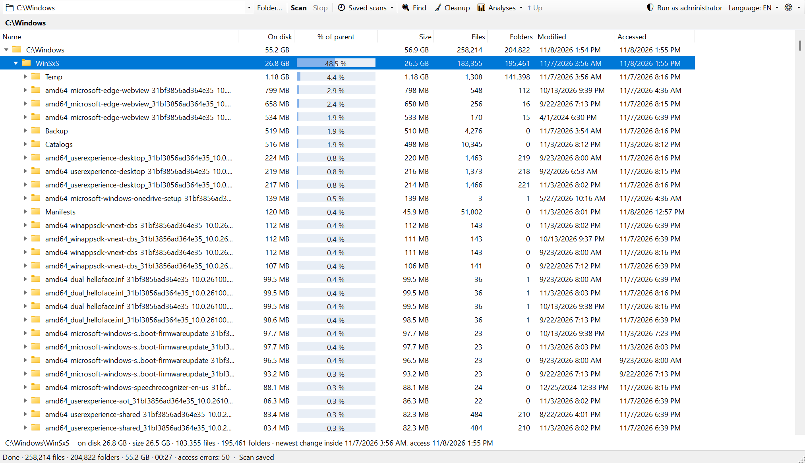

# DiskScope

**Rychlý portable nástroj pro Windows: kde mi zmizelo místo na disku a co můžu bezpečně smazat.**

[English](README.md) · Podrobná dokumentace je v angličtině ve složce [docs](docs).



DiskScope je portable aplikace pro Windows, která proskenuje disk nebo složku, spočítá rekurzivně
velikosti všech složek a umožní rychle najít, kde zabírají místo velké soubory a složky.

## Funkce

- Sken celého disku nebo vybrané složky, na libovolném souborovém systému (NTFS, exFAT, FAT32, ReFS).
- Paralelní procházení složek; velikosti se zobrazují průběžně, strom jde procházet už během skenu.
- Zobrazuje primárně **velikost na disku** (alokovanou), vedle ní logickou velikost, počty souborů a složek.
- Rychlý virtuální strom zvládne i desítky milionů položek; řazení podle libovolného sloupce.
- **Rychlý režim MFT** pro NTFS disky (při spuštění jako správce): čte přímo Master File Table, celý disk
  za desítky sekund. Pevné odkazy (hardlinky) se započítají jen jednou. Bez práv správce nebo na jiném
  souborovém systému se automaticky použije procházení složek.
- Junctions a symbolické odkazy se nenásledují (nic se nezapočítá dvakrát), cloudové soubory OneDrive se nestahují.
- **Mazání přes frontu**: smazané položky se řadí do fronty a mažou se jedna po druhé na pozadí, bez
  dialogů Windows. Můžete dál pracovat a přidávat další. Panel Mazání ukazuje stav každé položky a umí
  frontu pozastavit nebo zrušit. Trvalé mazání přeskočí zamčené soubory a nikdy nenásleduje junction.
- Zobrazení v Průzkumníku, otevření výchozí aplikací, kopírování cesty, nový sken složky a plné
  kontextové menu Windows (Shift + pravé tlačítko).
- **Analýzy**:
  - *Opuštěná data*: složky v AppData, ProgramData a Program Files, ke kterým nepatří žádný nainstalovaný
    program, a data odinstalovaných aplikací ze Store.
  - *Duplicity* (na vyžádání): soubory se stejným obsahem. Porovnává se velikost, pak začátek a konec
    souboru, nakonec celý obsah. Hardlinky se nehlásí, soubory jen v cloudu se nestahují.
  - *Mapa* (treemap): plocha odpovídá velikosti, barva typu souboru.
- **Položka „Analyzovat v DiskScope“** v kontextové nabídce Průzkumníku (volitelně, v nabídce ⚙).
- **Ukládání skenů**: dokončené skeny se ukládají a při dalším spuštění se poslední hned otevře. V okně
  Uložená data jde každý sken nebo všechny najednou smazat.
- **Porovnání se starším skenem**: sloupec Změna, řazení podle přírůstku, filtr „jen narostlé“.
  Ukáže, co od minula přibylo.
- **Hledání** (Ctrl+F): největší soubory, složky podle vlastního obsahu, filtr podle jména (`*.iso; *.zip`),
  velikosti a stáří, v celém stromu nebo jen v otevřené složce.
- **Poslední změna a poslední přístup**: u souboru jeho vlastní, u složky nejnovější uvnitř. Hledání umí
  „nezměněno / neotevřeno rok“. Pozor: přístup mohou aktualizovat i antivirus, indexování nebo zálohování.
- **Úklid**: katalog známých míst (dočasné soubory, mezipaměti prohlížečů a vývojových nástrojů, výpisy
  pádů, AI modely, virtuální disky Dockeru a WSL, systémové soubory…). U každého místa ukáže, kolik zabírá, jak
  bezpečné je ho smazat a jak místo uvolnit správně. Bezpečná místa lze vyprázdnit jedním kliknutím.
  Katalog je soubor JSON: „Upravit katalog…“ vytvoří `data\cleanup-catalog.json`, kde lze položky měnit,
  přidávat nebo vypínat (`"disabled": true`), bez nového sestavení aplikace.
- **Kopírovat dotaz pro AI** (Ctrl+Shift+C): sestaví popis souboru nebo složky (velikost, data, největší
  položky, typy souborů) s otázkami, k čemu slouží a zda je bezpečné ji smazat. Vložíte ho do libovolného AI
  asistenta. Aplikace sama nic neodesílá.
- Rozhraní v češtině a angličtině.

## Ovládání

| Klávesa / akce | Funkce |
|---|---|
| ← / → | sbalit / rozbalit, přejít na nadřazenou / první podsložku |
| Enter | vstoupit do složky (u souboru otevřít) |
| Backspace | o úroveň výš |
| dvojklik | rozbalit složku / otevřít soubor |
| Del / Shift+Del | přesunout do koše / smazat trvale |
| F5 | znovu skenovat složku |
| Ctrl+C | kopírovat cestu |
| Ctrl+F | hledání a největší soubory |
| klik na záhlaví | řazení |

## Spuštění

Stáhněte `DiskScope.exe` z [Releases](https://github.com/richardLipka/DiskScope/releases) a spusťte, nic se neinstaluje. Soubor zatím není digitálně podepsaný, takže Windows SmartScreen může varovat před neznámým vydavatelem: zvolte **Další informace → Přesto spustit**. Nastavení se ukládá do složky `data` vedle exe
(pokud do ní nelze zapisovat, do `%LOCALAPPDATA%\DiskScope`).

## Sestavení

Vyžaduje .NET 10 SDK.

```
dotnet test
dotnet publish src/DiskScope -c Release -r win-x64 --self-contained -p:PublishSingleFile=true -o publish
```

## Licence

[MIT](LICENSE) © 2026 Richard Lipka
