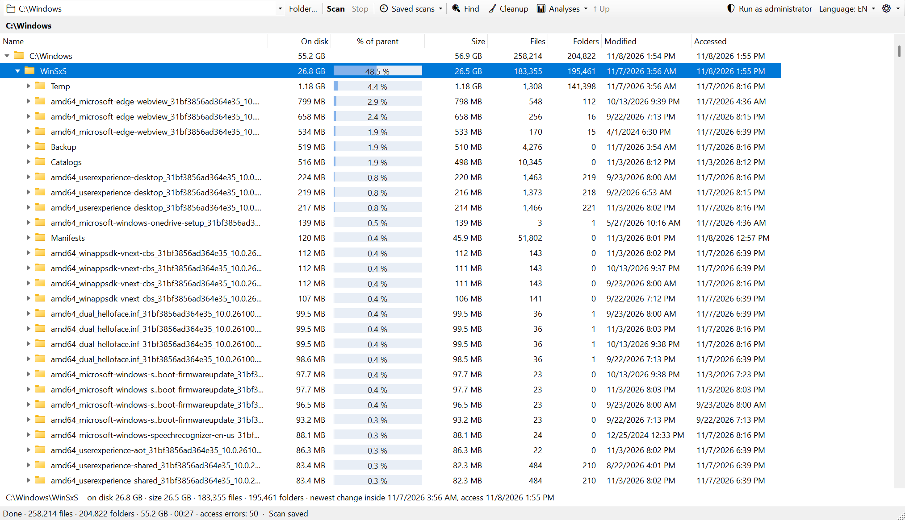
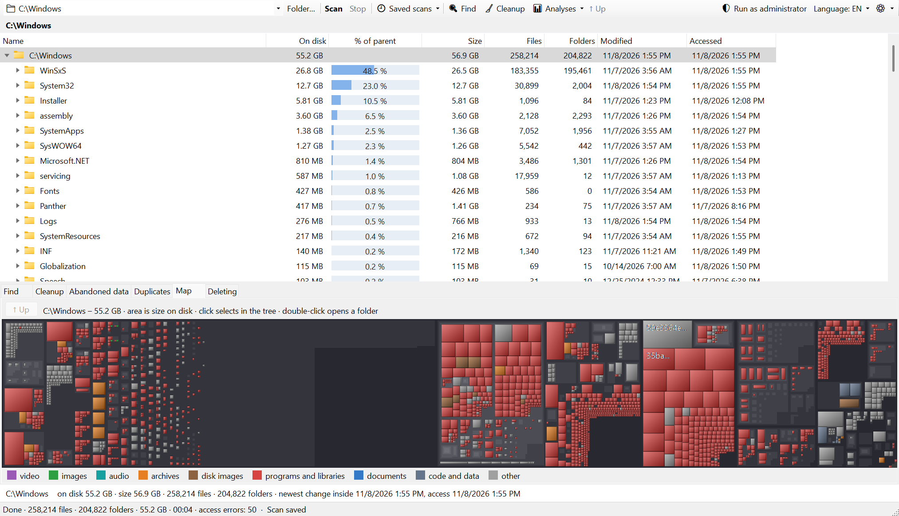
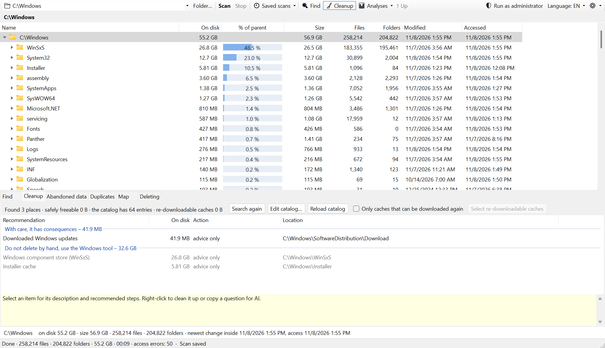
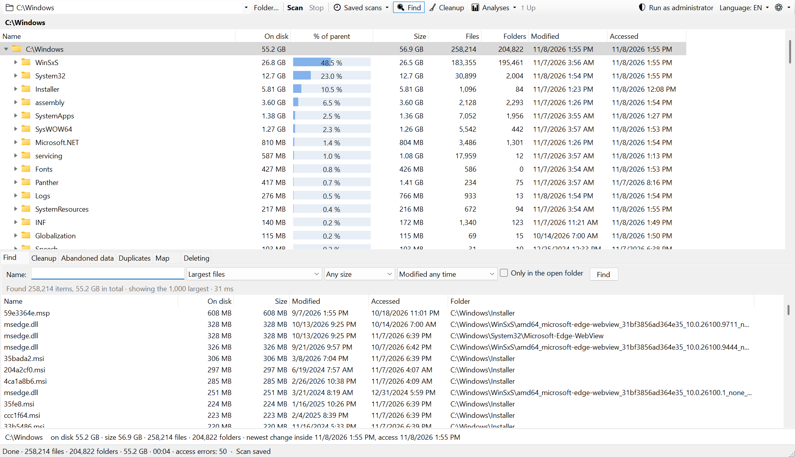

# DiskScope

**A fast, portable disk space analyzer and cleanup tool for Windows.**

DiskScope scans a drive or folder, adds up the size of every folder recursively and shows the result as a
tree you can browse while the scan is still running. It is built to answer one question quickly:
*where did my disk space go, and what can I safely delete?*

[Česky](README.cs.md) · [User guide](docs/user-guide.md) · [Cleanup catalog](docs/cleanup-catalog.md) ·
[Safety](docs/safety.md) · [Architecture](docs/architecture.md) · [Development](docs/development.md)



## Highlights

- **Fast on big disks.** Folders are listed in parallel with native NT calls. On NTFS, when run as
  administrator, DiskScope can read the Master File Table directly and scan a whole drive in tens of seconds.
  The tree handles tens of millions of entries: 30 million entries take about 2.2 GB of memory, and any
  sort or search finishes in under 2 seconds.
- **Size on disk first.** Allocated size is shown alongside logical size, file and folder counts, and the
  newest modification and access time inside each folder. Hard links are counted once. Junctions and
  symbolic links are not followed, and OneDrive cloud-only files are not downloaded.
- **Deleting without the drama.** Deleted items go into a queue and are removed one at a time in the
  background, with no Windows dialogs. You keep working and keep adding items. Drive roots, Windows,
  Program Files and user profile folders are protected whatever you select ([details](docs/safety.md)).
- **Find what to delete:**
  - **Search** for the largest files, for folders by their own content, by name, size and age, including
    "not opened for a year".
  - **Cleanup**: a catalog of 64 known places, such as temp folders, browser and developer caches
    (npm, Maven, Gradle, NuGet, pip, Cargo…), crash dumps, AI models and Docker/WSL disks. Each one comes
    with a safety rating and advice. The catalog is a plain JSON file you can extend.
  - **Abandoned data**: folders in AppData, ProgramData and Program Files that belong to no installed
    program.
  - **Duplicates**: files with the same content, checked step by step on request.
  - **Treemap**: area shows size, color shows file type.
  - **Compare with an earlier scan** to see what has grown.
  - **Copy question for AI** builds a description of a folder that you can paste into any AI assistant
    to ask what it is and whether it can go. DiskScope itself never sends anything anywhere.
- **Saved scans.** Finished scans are saved compressed and the last one opens instantly next time. The
  Saved data window deletes them individually or all at once.
- **Portable.** It is a single `.exe`: nothing is installed, and settings live in a `data` folder next to it.
  An optional "Analyze in DiskScope" entry can be added to Explorer's context menu (per user, no admin rights needed).
- **Czech and English** user interface.

| Treemap | Cleanup |
|---|---|
|  |  |



## Getting started

DiskScope needs Windows 10 or 11 (x64). The published `DiskScope.exe` is self-contained, so .NET does not need
to be installed.

1. Download `DiskScope.exe` from [Releases](https://github.com/richardLipka/DiskScope/releases), or build it
   (see below). The executable is not code-signed yet, so Windows SmartScreen may warn that it is from an
   unknown publisher: choose **More info → Run anyway**. Each release lists the file's SHA-256 checksum.
2. Run it, pick a drive or folder at the top left and press **Scan**.
3. Browse the tree; sizes update live. Right-click an item for Explorer, delete, rescan and more.

For the fast MFT scan of an NTFS drive, use **Run as administrator** in the toolbar. Without administrator
rights, DiskScope lists folders the normal way, which works on any file system (NTFS, ReFS, exFAT, FAT32).

The [user guide](docs/user-guide.md) covers every feature and keyboard shortcut.

## Building

Requires the [.NET 10 SDK](https://dotnet.microsoft.com/download).

```
dotnet test
powershell -File tools/publish.ps1      # single-file DiskScope.exe in ./publish
```

The [development notes](docs/development.md) cover the test suite, the stress tests and the automation hooks.

## Project layout

| Path | Contents |
|---|---|
| `src/DiskScope.Core` | Everything except the UI: node store, scanners (directory and MFT), saved scans, search, cleanup catalog, duplicates, abandoned data, deletion queue and safety checks |
| `src/DiskScope` | WinForms application: owner-drawn virtual tree, panels, Explorer integration, localization |
| `tests/DiskScope.Tests` | xUnit tests, including disk-error, deep-tree, concurrency and size stress tests |
| `tools` | Publish and icon scripts |
| `docs` | Documentation |

## License

[MIT](LICENSE) © 2026 Richard Lipka
